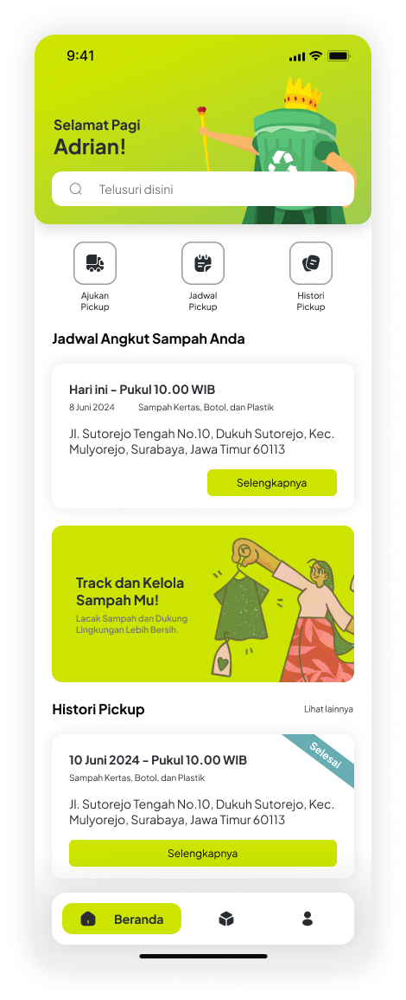
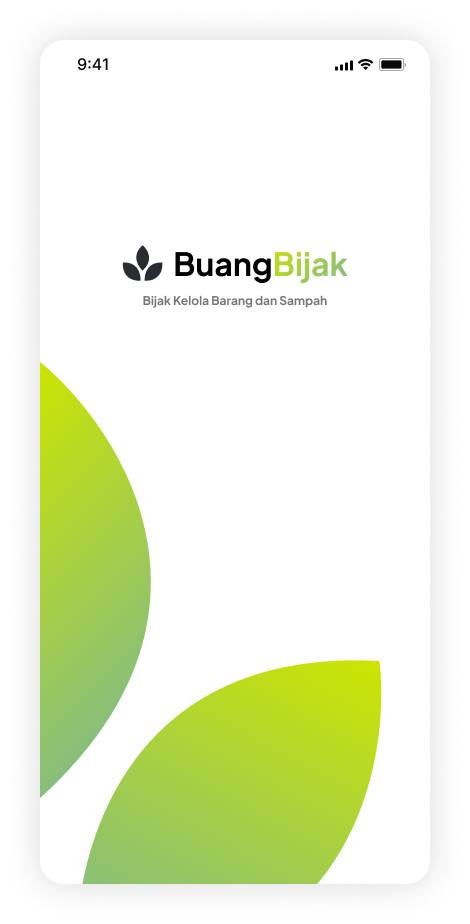
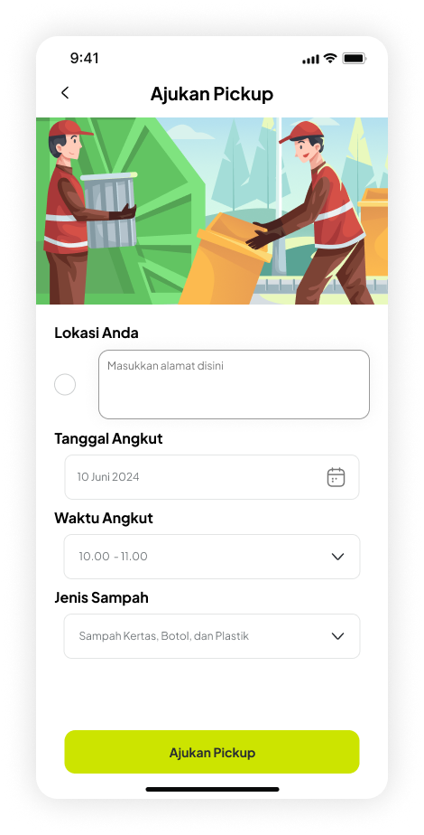
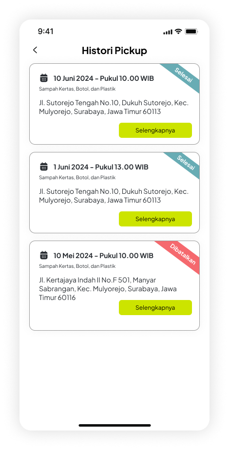
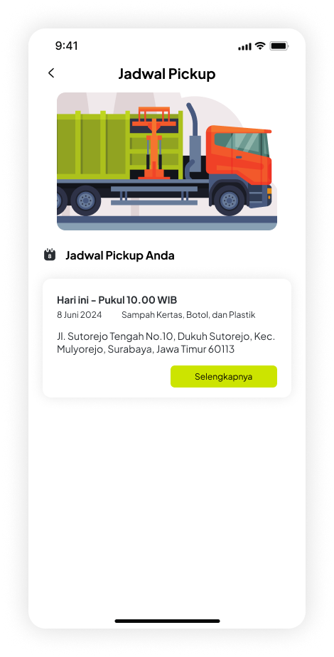
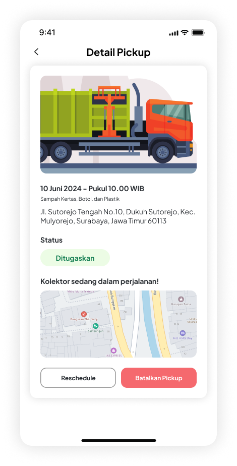

# 🗂️ BuangBijak - Aplikasi Pengelolaan Sampah On-Demand

<div align="center">

[](https://flutter.dev/)
[](https://firebase.google.com/)
[](https://dart.dev/)
[](LICENSE)

**BuangBijak** adalah aplikasi pengelolaan sampah on-demand yang menghubungkan pengguna dengan layanan penjemputan sampah, membantu mengatasi masalah sampah di Indonesia, serta mendukung kebersihan lingkungan.

### 🌐 Akses Aplikasi

**[Coba Aplikasi BuangBijak Klik Disini](https://its.id/m/aplikasi_tekber_d_kelompok_3)**

---

</div>

## 📱 Screenshots

<div align="center">

|                Homepage                 |                  Splash Screen                  |               Ajukan Pickup                |                History Pickup                |               Jadwal Pickup                |               Detail Pickup                |
| :-------------------------------------: | :---------------------------------------------: | :----------------------------------------: | :------------------------------------------: | :----------------------------------------: | :----------------------------------------: |
|  |  |  |  |  |  |

_Screenshots menunjukkan antarmuka utama aplikasi BuangBijak_

</div>

## ✨ Fitur Utama

### 👥 Untuk Pengguna

- 🏠 **Dashboard Pengguna** - Monitor status penjemputan sampah secara real-time
- 📅 **Penjadwalan Pickup** - Atur jadwal penjemputan sampah dengan mudah dan fleksibel
- 📱 **Tracking Sampah** - Pantau status penjemputan dari pengajuan hingga selesai
- 📜 **Riwayat Transaksi** - Lihat riwayat penjemputan lengkap dengan detail
- 🔄 **Revisi Jadwal** - Ubah jadwal pickup yang telah diajukan (maksimal 1x)
- 👤 **Manajemen Profil** - Kelola informasi pengguna dan preferensi
- 🔔 **Notifikasi** - Terima update status penjemputan secara otomatis

### 🛠️ Untuk Admin

- 📊 **Dashboard Admin** - Kelola seluruh operasi penjemputan sampah
- ✅ **Manajemen Status** - Terima, tolak, atau selesaikan permintaan pickup
- 📋 **Filter Data** - Filter pickup berdasarkan status (Pending, Success, Cancel)

### 🎯 Jenis Sampah yang Dilayani

- 📄 **Sampah Kertas** - Kertas bekas, kardus, dokumen
- 🍶 **Sampah Botol & Kaca** - Botol plastik, botol kaca, wadah kaca
- 🥤 **Sampah Plastik** - Kemasan plastik, kantong plastik
- ⚙️ **Sampah Logam** - Kaleng, logam bekas, komponen elektronik

## 🏗️ Arsitektur & Teknologi

### Tech Stack

- 💙 **[Flutter](https://flutter.dev/)** - Framework UI cross-platform
- 🔥 **[Firebase](https://firebase.google.com/)** - Backend as a Service
  - **Firebase Auth** - Sistem autentikasi pengguna
  - **Cloud Firestore** - Database NoSQL real-time
  - **Firebase Storage** - Penyimpanan file dan media
- 🎯 **[Dart](https://dart.dev/)** - Bahasa pemrograman utama

### Dependencies Utama

```yaml
dependencies:
  flutter: sdk: flutter
  firebase_core: ^3.8.0          # Firebase Core SDK
  firebase_auth: ^5.3.3          # Authentication
  cloud_firestore: ^5.5.0        # Firestore Database
  flutter_floating_bottom_bar: ^1.2.0  # Bottom Navigation
  logger: ^2.5.0                  # Logging System
  uuid: ^4.5.1                    # Unique ID Generator
  intl: ^0.20.1                   # Internationalization
  cupertino_icons: ^1.0.8         # iOS Icons
```

### Arsitektur Aplikasi

```
lib/
├── 🎯 main.dart                 # Entry point aplikasi
├── 🎨 theme.dart               # Theme dan styling
├── 🔥 firebase_options.dart     # Konfigurasi Firebase
├── 📊 data/                    # Data layer dan API services
├── 📝 models/                  # Data models dan entities
├── 🛣️ routes/                  # Routing configuration
├── 📱 screens/                 # UI screens dan pages
│   ├── 🏠 home_screen.dart
│   ├── 📊 dashboard.dart
│   ├── 📅 pickup_screens.dart
│   ├── 👤 user_screen.dart
│   └── ⚙️ user_settings.dart
├── 🔧 utils/                   # Utility functions dan helpers
├── 🧩 widgets/                 # Reusable UI components
│   ├── 🔘 button.dart
│   ├── 📅 date_picker.dart
│   ├── 📋 dropdown.dart
│   └── 📊 dashboard_card.dart
└── 🗂️ assets/                  # Static assets
    ├── 🖼️ images/
    ├── 🎨 icons/
    └── ✍️ fonts/
```

## 🚀 Panduan Instalasi & Setup

### 📋 Prerequisites

Pastikan Anda telah menginstall:

- **[Flutter SDK](https://flutter.dev/docs/get-started/install)** (≥3.5.4)
- **[Dart SDK](https://dart.dev/get-dart)** (≥3.5.4)
- **[Android Studio](https://developer.android.com/studio)** atau **[VS Code](https://code.visualstudio.com/)**
- **[Git](https://git-scm.com/)** untuk version control
- **[Node.js](https://nodejs.org/)** (untuk Firebase CLI)

### 🔧 Langkah Instalasi

#### 1. Clone Repository

```bash
git clone https://github.com/your-username/fp-tekber-kel-3.git
cd fp-tekber-kel-3
```

#### 2. Install Dependencies

```bash
flutter pub get
```

#### 3. Setup Firebase

- Buat project baru di [Firebase Console](https://console.firebase.google.com/)
- Aktifkan **Authentication** (Email/Password)
- Aktifkan **Cloud Firestore** database
- Aktifkan **Firebase Storage** (opsional)

**Untuk Android:**

```bash
# Download google-services.json dari Firebase Console
# Letakkan di: android/app/google-services.json
```

**Untuk iOS:**

```bash
# Download GoogleService-Info.plist dari Firebase Console
# Letakkan di: ios/Runner/GoogleService-Info.plist
```

#### 4. Konfigurasi Firebase CLI (Opsional)

```bash
npm install -g firebase-tools
firebase login
firebase init
```

#### 5. Generate Launcher Icons

```bash
flutter pub run flutter_launcher_icons:main
```

#### 6. Jalankan Aplikasi

```bash
# Debug mode
flutter run

# Untuk device spesifik
flutter run -d chrome          # Web
flutter run -d android         # Android
flutter run -d ios             # iOS
```

### 📋 Konfigurasi Environment

#### Firebase Configuration

File `lib/firebase_options.dart` sudah dikonfigurasi dengan:

- **Project ID**: `buang-bijak`
- **Storage Bucket**: `buang-bijak.firebasestorage.app`
- **Messaging Sender ID**: `709894121389`

#### Firestore Security Rules

```javascript
rules_version = '2';
service cloud.firestore {
  match /databases/{database}/documents {
    // Users collection
    match /users/{userId} {
      allow read, write: if request.auth != null && request.auth.uid == userId;
    }

    // Pickup requests collection
    match /ajukan_pickup/{pickupId} {
      allow read, write: if request.auth != null;
    }
  }
}
```

## 📱 Platform Support

<div align="center">

| Platform       | Status       | Minimum Version       |
| -------------- | ------------ | --------------------- |
| 🤖 **Android** | ✅ Supported | API 21+ (Android 5.0) |
| 🍎 **iOS**     | ✅ Supported | iOS 11.0+             |
| 🌐 **Web**     | ✅ Supported | Modern Browsers       |
| 🖥️ **macOS**   | ✅ Supported | macOS 10.14+          |
| 🖥️ **Windows** | ✅ Supported | Windows 10+           |
| 🐧 **Linux**   | ✅ Supported | Ubuntu 18.04+         |

</div>

## 🧪 Testing & Quality Assurance

### Menjalankan Tests

```bash
# Unit tests
flutter test

# Integration tests
flutter drive --target=test_driver/app.dart

# Test dengan coverage
flutter test --coverage
lcov --summary coverage/lcov.info
```

### Code Quality

```bash
# Format code
flutter format .

# Analyze code
flutter analyze

# Check untuk unused dependencies
flutter pub deps
```

## 📦 Build & Deployment

### 🤖 Android Build

```bash
# Debug APK
flutter build apk --debug

# Release APK
flutter build apk --release

# Android App Bundle (Recommended untuk Play Store)
flutter build appbundle --release
```

### 🍎 iOS Build

```bash
# Build untuk iOS
flutter build ios --release

# Build untuk iOS Simulator
flutter build ios --debug --simulator
```

### 🌐 Web Build

```bash
# Build untuk web
flutter build web --release

# Build dengan base href spesifik
flutter build web --base-href "/buang-bijak/"
```

### 🖥️ Desktop Build

```bash
# Windows
flutter build windows --release

# macOS
flutter build macos --release

# Linux
flutter build linux --release
```

## 📄 License & Legal

```
Copyright (c) 2024 Kelompok 3 - Final Project Teknologi Berkembang

Project ini bersifat private untuk keperluan akademik.
Semua hak cipta dilindungi undang-undang.

Tidak diperbolehkan untuk:
- Menggunakan untuk keperluan komersial
- Mendistribusikan tanpa izin
- Mengklaim sebagai karya sendiri
```

## 👥 Team & Credits

### 🎓 Kelompok 3 - Final Project Teknologi Berkembang

<div align="start">

| Nama                             | NRP          |
| -------------------------------- | ------------ |
| **Dzaky Purnomo Rifa’i**         | `5026221085` |
| **Muhammad Razan Parisya Putra** | `5026231174` |
| **Felicia Evelina Soetjipto**    | `5026221072` |
| **Kentaro Mas’ud Mizoguchi**     | `5026211007` |

</div>

### 🏫 Institution

**Institut Teknologi Sepuluh Nopember (ITS)**  
Mata Kuliah: Teknologi Berkembang  
Semester: Ganjil 2024/2025

## 🔄 Changelog & Roadmap

### 📅 Version History

#### [v1.0.0] - 2024-12-12

**🎉 Initial Release - MVP (Minimum Viable Product)**

**✨ New Features:**

- ✅ Sistem autentikasi pengguna (Login/Register)
- ✅ Dashboard pengguna untuk monitoring pickup
- ✅ Penjadwalan pickup sampah dengan berbagai jenis
- ✅ Dashboard admin untuk manajemen pickup
- ✅ Sistem status tracking (Pending, Success, Cancel)
- ✅ Fitur revisi jadwal pickup (1x per order)
- ✅ Riwayat transaksi lengkap
- ✅ Manajemen profil pengguna
- ✅ Real-time updates dengan Firestore
- ✅ Support multi-platform (Android, iOS, Web)

**🛠️ Technical Implementation:**

- ✅ Firebase Authentication integration
- ✅ Cloud Firestore database structure
- ✅ Responsive UI design
- ✅ State management dengan StatefulWidget
- ✅ Navigation system dengan named routes
- ✅ Custom widgets dan components
- ✅ Date/time handling dengan intl package
- ✅ Logging system dengan Logger package

## 🙏 Acknowledgments & References

### 🛠️ Technology Stack Credits

- **[Flutter Team](https://flutter.dev/community)** - Framework UI yang luar biasa untuk cross-platform development
- **[Firebase Team](https://firebase.google.com/)** - Backend services yang reliable dan scalable
- **[Google](https://developers.google.com/)** - Material Design guidelines dan developer tools
- **[Dart Team](https://dart.dev/)** - Bahasa pemrograman yang powerful dan modern

### 📚 Learning Resources & Inspiration

- **[Flutter Documentation](https://docs.flutter.dev/)** - Comprehensive documentation dan tutorials
- **[Firebase Documentation](https://firebase.google.com/docs)** - Backend integration guides
- **[Material Design](https://material.io/)** - Design system dan UI/UX guidelines
- **[Effective Dart](https://dart.dev/guides/language/effective-dart)** - Code style guidelines
- **[FlutterFire](https://firebase.flutter.dev/)** - Firebase plugins untuk Flutter

### 🌟 Open Source Libraries

```yaml
# Special thanks to these amazing open source contributors:
flutter_floating_bottom_bar: ^1.2.0 # Bottom navigation component
logger: ^2.5.0 # Logging system
uuid: ^4.5.1 # UUID generation
intl: ^0.20.1 # Internationalization support
cupertino_icons: ^1.0.8 # iOS-style icons
```

### 🎨 Design & Assets Credits

- **Icons**: Material Design Icons & Custom icons dari tim desain
- **Images**: Custom illustrations dan stock photos dengan proper licensing
- **Fonts**: Plus Jakarta Sans - Open source font family
- **Color Scheme**: Material Design color palette dengan custom brand colors

### 🌍 Environmental Impact Inspiration

Project ini terinspirasi dari:

- **UN Sustainable Development Goals** - Khususnya Goal 11 (Sustainable Cities) dan Goal 12 (Responsible Consumption)
- **Indonesia's Waste Management Challenges** - Membantu mengatasi masalah sampah di perkotaan
- **Circular Economy Principles** - Mendukung ekonomi sirkular dan daur ulang

<div align="center">

---

### 💚 Made with Love for a Cleaner Indonesia

**"Bijak Kelola Barang dan Sampah"**

[](https://flutter.dev/)
[](https://firebase.google.com/)
[](https://its.ac.id/)

**© 2024 Kelompok 3 - Final Project Teknologi Berkembang**  
_Institut Teknologi Sepuluh Nopember (ITS)_

---

**🌱 "Setiap sampah yang terkelola dengan baik adalah langkah kecil menuju Indonesia yang lebih bersih dan hijau"**

</div>
